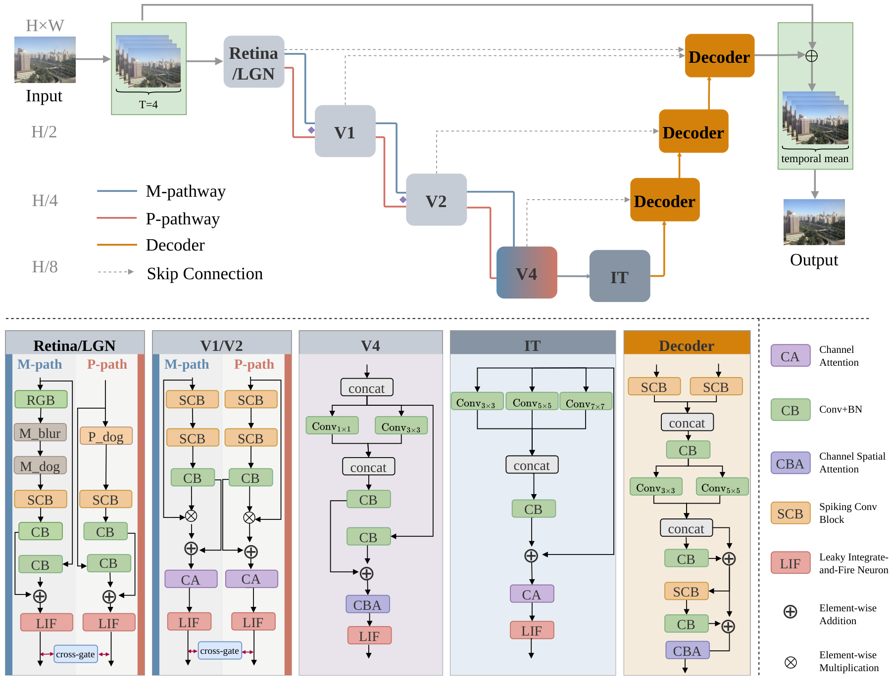

# VentralNetSNN: A Ventral Pathway-Inspired Spiking Neural Network for Image Restoration


Official PyTorch implementation of **"A Ventral Pathway-Inspired Spiking Neural Network for Image Restoration"** (under review).

## News

- **2026.09** Code released.

## Abstract

Image restoration seeks to recover clean visual content from degraded observations such as haze and rain, in which spatially varying degradations simultaneously corrupt global scene structures and local fine-grained details. Most existing deep learning methods adopt feedforward architectures and purely static spatial modeling, and therefore couple global degradation estimation, local detail recovery, and structural consistency within a single representation space, which restricts their robustness under heterogeneous or strongly mixed degradations. To address these limitations, this article proposes VentralNetSNN, a spiking neural network (SNN) for image restoration inspired by the hierarchical organization of the ventral visual pathway. The framework employs a dual-stream spiking architecture that explicitly decouples global structure estimation from local detail reconstruction, and an adaptive cross-pathway interaction mechanism that regulates information exchange between the two streams. In addition, a spike-driven temporal aggregation scheme is developed to reformulate restoration as a progressive evidence-accumulation process, where membrane-potential dynamics integrate visual evidence across time steps to yield more stable and robust reconstruction. Extensive experiments on representative dehazing and deraining benchmarks show that VentralNetSNN attains superior or competitive restoration quality and consistent generalization across degradation types, while preserving the event-driven and energy-efficient properties of SNNs. These results indicate that the synergistic integration of hierarchical ventral-stream modeling and spike-driven temporal aggregation substantially strengthens the representation and restoration capability of SNN-based vision systems.

## Network Architecture



## Installation

```bash
conda create -n ventralnet python=3.10 -y
conda activate ventralnet
pip install -r requirements.txt
```

The experiments were run with PyTorch 2.6.0 (CUDA 12.4), torchvision 0.21.0 and SpikingJelly 0.0.0.0.14. The perceptual loss uses ImageNet-pretrained VGG16, which torchvision downloads on the first run.

## Datasets

| Dataset | Task | Download |
|---|---|---|
| RESIDE ITS / OTS / SOTS | Dehazing | [RESIDE](https://sites.google.com/view/reside-dehaze-datasets) |
| RainTrainH / Rain100H, RainTrainL / Rain100L | Deraining | [PReNet](https://github.com/csdwren/PReNet) |

Expected layout (pass the root with `--data_root` or set it in the config):

```
RESIDE-IN/                     # also RESIDE-OUT
├── train/hazy/   train/GT/
└── test/hazy/    test/GT/     # a GT image has the same file name as its hazy image

Rain100H/                      # also Rain100L (RainTrainL/)
├── RainTrainH/                # rain-*.png and norain-*.png
└── Rain100H/                  # norain-*.png
    └── rainy/                 # rain-*.png
```

## Training

```bash
python train.py --config configs/its.yaml      --seed 42 --save_dir results/its/seed_42
python train.py --config configs/ots.yaml      --seed 42 --save_dir results/ots/seed_42
python train.py --config configs/rain100h.yaml --seed 42 --save_dir results/rain100h/seed_42
python train.py --config configs/rain100l.yaml --seed 42 --save_dir results/rain100l/seed_42
```

All settings live in `configs/`; any value can be overridden on the command line. Shared settings: AdamW (lr 2e-4, weight decay 1e-4) with cosine annealing to 1e-6, batch size 4, 256×256 inputs, T = 4 time steps, gradient clipping at 1.0, random horizontal and vertical flips. The loss is Charbonnier + λ<sub>ssim</sub>(1 − SSIM) + λ<sub>perc</sub>·VGG16 perceptual loss, with λ<sub>perc</sub> halved during the first 30 epochs.

| Config | Epochs | λ<sub>ssim</sub> | λ<sub>perc</sub> |
|---|---|---|---|
| `its.yaml` / `ots.yaml` | 200 | 0.15 | 0.05 |
| `rain100h.yaml` | 300 | 0.5 | 0.1 |
| `rain100l.yaml` | 300 | 1.0 | 0.01 |

`--seed` sets the model initialization and `--split_seed` the data order and augmentation. Each run writes `best.pth`, `config.json`, `history.jsonl` (per-epoch loss and test metrics), `result.json` and `per_image_metrics.csv` to `--save_dir`.

## Evaluation

```bash
# 256x256 protocol (as in training), with latency
python test.py --config configs/its.yaml --checkpoint results/its/seed_42/best.pth --measure_latency

# native resolution, saving the restored images
python test.py --config configs/its.yaml --checkpoint results/its/seed_42/best.pth --eval_resolution native --save_images
```

`test.py` reports L1 / PSNR / SSIM, the spike firing rate (overall and per LIF layer) and, with `--measure_latency`, the inference latency at batch size 1. Results are written to `<checkpoint dir>/eval_<resolution>/`.

## Citation

The BibTeX entry will be added once the paper is published.

## Acknowledgement

This implementation is built on [SpikingJelly](https://github.com/fangwei123456/spikingjelly). We thank the authors of [RESIDE](https://sites.google.com/view/reside-dehaze-datasets) and [PReNet](https://github.com/csdwren/PReNet) for releasing their datasets.

## License

This project is released under the [MIT License](LICENSE).
